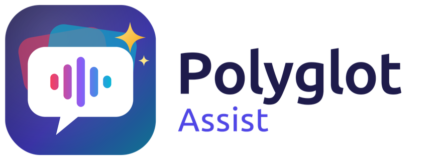

**Many languages. One Home Assistant pipeline. One wake word.**

Speak any language your speech recognition and TTS understand, and several of
them to the same voice satellite, without switching the wake word or the
pipeline. The same command runs locally in a
few milliseconds and answers in the language you spoke. Only what no command
matches goes on to your AI agent (any HA conversation agent).

**New: local intents that teach themselves.** Polyglot notices which
sentences keep ending up at your AI agent. Your AI task turns the recurring
ones into validated local commands in every language. You accept them in the
panel, or by voice: *"What have you learned?" → "Accept the first one" →
"Yes"*.

- **HA's built-in commands in every language**, with target checks.
- **Panel:** commands with hit counters, a test field, the editor, names per
  language, suggestions, version history with restore, and all settings.
  Ships in English, German and French; any other language as a file or
  translated by your AI.
- **Safe by design:** suggestions are validated against a regression corpus
  and never applied silently. Doors, locks and alarms are protected.
- **Confirmation tone like HA's own, with any TTS:** classic, designed or your
  own uploaded or recorded tone.
- **Light:** about 16 MB with 3 languages enabled and about 2 ms per hit. Runs on
  typical HA hardware.

**Which languages?** Any your STT and TTS support; ideally also your AI task
(suggestions, self-learning) and your fallback agent. The panel's language
check shows what each part supports.

**Companion:** [Polyglot TTS](https://github.com/Nosdave/polyglot-tts) speaks
every answer in its own language with one voice: seven languages, streaming,
Wyoming for HA. Together with a multilingual STT, the whole pipeline becomes
multilingual.

See the README for setup.
